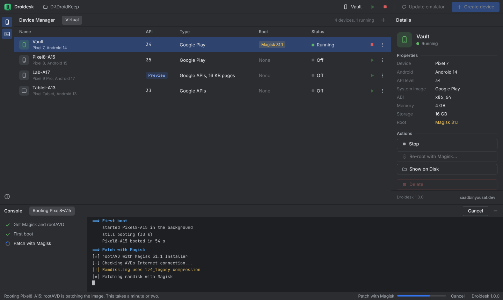

<!-- // © https://saadbinyousaf.dev/ © // -->

  
  
  
  

## Introduction

Droidesk runs Google's official Android emulator on Windows without Android Studio, and roots it with Magisk in one step. It downloads only what it needs, keeps everything inside a single portable folder, and gives you a Device Manager that looks and feels like the one in Android Studio.

Use it to keep authenticator and private apps on a phone that lives on your PC, to test apps on any Android version, or to have a rooted device ready for development and research, all without installing a full IDE.

## Highlights

- **No Android Studio.** Only the emulator, its command-line tools and the system images you pick are installed, inside the Droidesk folder.
- **Any Android version.** Android 11 through 16 with Google Play or Google APIs images, plus Android 17 preview images as soon as Google publishes them.
- **Root with Magisk in one step.** Pick a Stable, Beta or Canary Magisk build from its GitHub releases while creating a device, or root an existing one later.
- **Portable.** Back the folder up, move it to another drive, or reinstall Windows and run Droidesk again. Every device comes back exactly as it was.
- **One window.** Setup, downloads, creating and rooting run inside the app with a live console. No terminal windows to keep open.
- **Built for real connections.** Downloads resume after drops, retry on their own and stop with a clear message instead of hanging.

## Downloads

**[Download the latest release](https://github.com/saadbinyousaf1/Droidesk/releases/latest)**, extract it to a folder without spaces (for example `D:\Droidesk`) and open `Droidesk.bat`.

Every release is built automatically from this repository by GitHub Actions. Droidesk itself is a set of PowerShell scripts and one HTML file, so you can read exactly what it does before running it.

## Useful Links

- [Installation](docs/install.md)
- [User guide](docs/guide.md)
- [FAQ and troubleshooting](docs/faq.md)
- [Changelog](docs/changes.md)
- [Development](docs/development.md)

## Requirements

| | |
| --- | --- |
| Operating system | Windows 10 (1809 or newer) or Windows 11, 64-bit |
| Processor | Intel or AMD with virtualization turned on in BIOS/UEFI |
| Memory | 8 GB, 16 GB recommended |
| Disk | About 1 GB for Droidesk, plus 3 to 6 GB per Android version and 2 to 10 GB per device |
| Internet | Needed for setup and the first download of each Android version |

## Bug Reports

Before opening an issue, check the [FAQ](docs/faq.md) and search existing issues. When you [report a bug](https://github.com/saadbinyousaf1/Droidesk/issues/new/choose), include your Windows version, the Droidesk version from the status bar, and the console log of the failed task (**Console** at the bottom of the window). Reports without a log are hard to act on and may be closed.

## Contributing

Pull requests are welcome. Read [CONTRIBUTING.md](CONTRIBUTING.md) first, and see [Development](docs/development.md) for how Droidesk is put together.

## Credits

Droidesk is a front end. The heavy lifting is done by these projects, each downloaded from its official source on your machine and never bundled:

- [Android Emulator](https://developer.android.com/studio/run/emulator) and SDK tools by Google
- [rootAVD](https://gitlab.com/newbit/rootAVD) by newbit
- [Magisk](https://github.com/topjohnwu/Magisk) by topjohnwu
- [Eclipse Temurin](https://adoptium.net/) Java builds
- [Microsoft Edge WebView2](https://developer.microsoft.com/microsoft-edge/webview2/)

Droidesk is an independent project. It isn't affiliated with or endorsed by Google, Android, Android Studio or Magisk.

## License

    Droidesk
    Copyright (c) 2026 Saad bin Yousaf (https://saadbinyousaf.dev/)

    Released under the MIT License. You may use, copy, modify, merge,
    publish, distribute, sublicense and sell copies of the software,
    provided the copyright notice and the permission notice are included
    in all copies or substantial portions of it.

    The software is provided "as is", without warranty of any kind.

See [LICENSE](LICENSE) for the full text.
