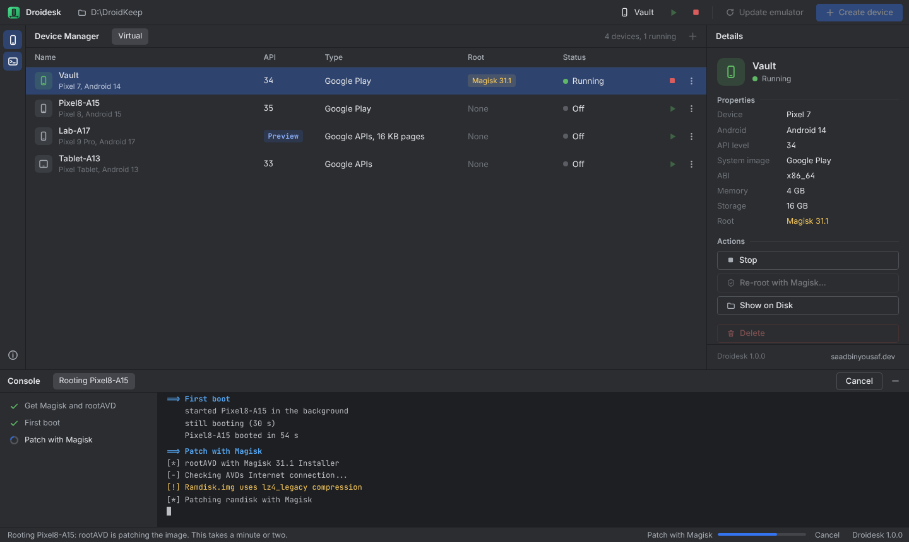

<!-- // © https://saadbinyousaf.dev/ © // -->
<p align="center">
  
</p>

<h1 align="center">Droidesk</h1>

<p align="center">
  <b>Rooted Android emulators on Windows. No Android Studio.</b><br>
  Create, root and run Android 11 to 17 virtual phones from one portable folder.
</p>

<p align="center">
  
  
  
</p>

<p align="center">
  
</p>

---

## Why Droidesk

Google's Android emulator is the most faithful way to run Android on a PC, but it normally comes buried inside Android Studio, which is gigabytes of IDE you don't need just to run a phone. Rooting it with Magisk usually means juggling scripts by hand.

Droidesk gives you the official emulator, Magisk root, and a familiar Device Manager styled after Android Studio, all inside one folder you can back up, move to another drive, or carry over after a Windows reinstall.

## Features

- **Feels like Android Studio, without it.** A familiar dark Device Manager, setup wizard and console, using the same Inter and JetBrains Mono fonts. Only the command-line tools, the emulator and the Android images you pick get installed.
- **Any Android version.** Android 11 through 16, plus Android 17 preview images as soon as Google publishes them.
- **One-click Magisk root.** Pick Stable, Beta or Canary straight from Magisk's GitHub releases; patching is done with rootAVD.
- **Real device profiles.** Pixel 9 Pro, Pixel 8, Pixel Tablet and every other profile Google ships, with Google Play or Google APIs images.
- **Portable.** SDK, Java, devices and settings live in one folder. Reinstall Windows, run setup again, and every device comes back exactly as it was.
- **One window.** Setup, downloads, creating and rooting all run inside the app with a live log. No console windows, and closing Droidesk leaves running devices alone.
- **Network-proof.** Downloads resume after drops, retry automatically, and never hang on a dead connection.
- **Safe updates.** Updating the emulator never touches your rooted system images.

## Requirements

- Windows 10 or 11, 64-bit
- A CPU with virtualization turned on in BIOS/UEFI (Intel VT-x or AMD-V)
- About 10 GB free for the first device, 3 to 6 GB for each additional Android version
- An internet connection for the first setup

## Install

1. Download the latest release and put the `Droidesk` folder somewhere **without spaces**, for example `D:\Droidesk`.
   Before extracting the zip, right-click it, choose **Properties**, tick **Unblock** and press OK. Otherwise Windows warns about an unknown publisher.
2. Open **`Droidesk.bat`**. That's the only file you ever need to open.

The first time, Droidesk opens a setup wizard with a live log. Press **Install** and it downloads a portable Java, the Android tools and the emulator (about 700 MB) into its own folder. Slow or dropped connections are handled: downloads resume, retry, and stop with a clear message instead of hanging. If Windows Hypervisor Platform is off, Windows asks for admin rights once and then needs one restart.

When setup is done, create your first device and Droidesk adds a shortcut to your desktop.

## Using it

| To do this | Do this |
| --- | --- |
| Start a device | The green ▶ next to it, double-click the row, or **Start** in Details |
| Fresh boot without the saved state | ⋮ or right-click, then **Cold Boot Now** |
| Add a device | **Create device**, then pick a device definition, a system image, memory and storage |
| Get newer Android versions | In **Create device**, choose **Check for new versions** |
| Root a device | ⋮, then **Root with Magisk...**, and pick a Magisk build |
| Watch progress | The **Console** at the bottom opens by itself while something runs |
| Update the emulator | Stop every device, then **Update emulator** in the toolbar |

After rooting, cold start the device once, open the Magisk app and accept its additional setup.

> Rooting patches the Android **image**, which is shared. Every device built on the same Android version and image type gets Magisk too.

## Moving or reinstalling Windows

Everything Droidesk needs lives in its own folder. Keep it on a drive you don't format, or copy it somewhere safe while all devices are off. After reinstalling Windows, open `Droidesk.bat`: it notices what's already there, re-runs only the missing parts of setup and puts the shortcut back. Your devices come back exactly as you left them.

## Folder layout

```
Droidesk/
├─ Droidesk.bat   the only file to open
├─ core/           the app itself (scripts, interface, logo)
└─ data/           created on first run: emulator, Android images,
                   your devices, Java and Magisk
```

To back up every device, back up `data`. To reset Droidesk completely, delete `data`.

## Troubleshooting

- **A device won't start:** make sure virtualization is enabled in BIOS. Droidesk turns on Windows Hypervisor Platform for you during setup.
- **A download keeps failing:** press **Show details** to see the log, then **Retry**. Finished downloads are kept.
- **Rooting fails on Android 17 or a 16 KB page image:** those images are new and rootAVD may not support them yet. The device still works without root; Android 15 is the safest choice for root.
- **A `.ps1` file opens in Notepad:** that's normal on Windows. Only open `Droidesk.bat` or the desktop shortcut.
- **The app window doesn't open:** Droidesk downloads Microsoft's WebView2 libraries on first launch. If that's blocked, it falls back to an Edge app window.

## Credits

Droidesk stands on the shoulders of:

- [Android Emulator](https://developer.android.com/studio/run/emulator) by Google
- [rootAVD](https://gitlab.com/newbit/rootAVD) by newbit
- [Magisk](https://github.com/topjohnwu/Magisk) by topjohnwu
- [Eclipse Temurin](https://adoptium.net/) Java builds
- [Microsoft Edge WebView2](https://developer.microsoft.com/microsoft-edge/webview2/)

None of these are bundled. Droidesk downloads each one from its official source on your machine.

## Disclaimer

Droidesk is an independent project and isn't affiliated with or endorsed by Google, Android or Magisk. Rooting changes how a device behaves; use it on virtual devices you own and at your own risk.

## License

[MIT](LICENSE) © 2026 Saad bin Yousaf

---

<p align="center">
  Made by <a href="https://saadbinyousaf.dev/">Saad bin Yousaf</a>
</p>
